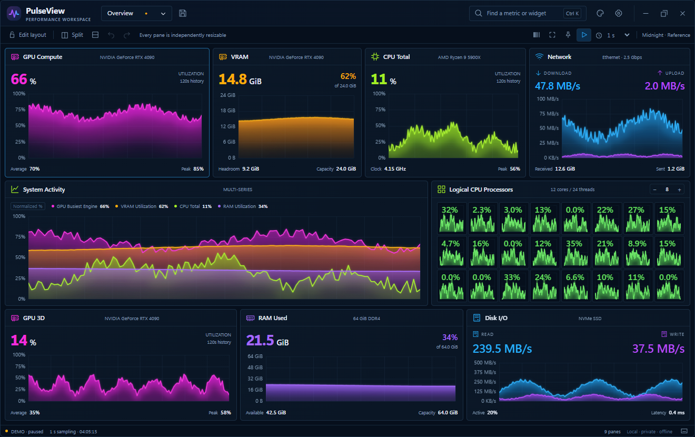

# PulseView 1.1.0 — پنل پرفورمنس ماژولار ویندوز

**C++20 + Win32 + WebView2، با رابط HTML/CSS/JavaScript محلی.**

این بسته سورس پروژه است، نه فایل نصب آماده. رابط واقعی در Chromium اجرا و تست شده و تست‌های مستقل محاسبات C++ نیز روی لینوکس اجرا شده‌اند. بخش اختصاصی ویندوز پیاده‌سازی شده، اما در محیط تحویل امکان کامپایل یا اجرای Win32/WebView2 وجود نداشته است. بنابراین فایل EXE بیلدشده در این ZIP نیست و قبل از انتشار، چک‌لیست ویندوز باید انجام شود. تصاویر داخل پروژه از رابط واقعی با **داده‌های شبیه‌سازی‌شدهٔ مشخص‌شده با DEMO** هستند، نه اندازه‌گیری سخت‌افزار.

راهنمای کامل فنی: [README.md](README.md). نقطهٔ شروع مدل‌های هوش مصنوعی: **[agent.md](agent.md)**؛ فایل `AGENTS.md` نیز به همان راهنما ارجاع می‌دهد.



## تغییرات نسخهٔ ۱٫۱ — کد واقعی، نه تصویرسازی

**با میدل‌کلیک روی نمودار**، نوار عنوان، منوی اصلی، تولبار، نوار فوکوس و فوتر مخفی می‌شوند؛ فقط پنل ماژولار باقی می‌ماند. میدل‌کلیک دوباره همهٔ نوارها را برمی‌گرداند. اندازهٔ بیرونی پنجره، درخت چیدمان، نسبت اسپلیت‌ها و تاریخچه عوض نمی‌شوند؛ خود پنل‌ها و Canvasها هم از نو ساخته نمی‌شوند. این حالت با پریست و نشست خودکار ذخیره می‌شود و از گزینهٔ «فاصله‌گذاری فشرده» مستقل است.

**Ctrl+Shift+C** همان تغییر حالت را انجام می‌دهد. **Escape** ابتدا دیالوگ باز را می‌بندد، در غیر این صورت نوارها را ظاهر می‌کند؛ با Escape بعدی از فوکوس یک پنل هم خارج می‌شوی. راست‌کلیک روی پنل در حالت کامپکت همچنان منو، انتخاب اسکین و گزینهٔ **Show application bars** را در دسترس نگه می‌دارد. عنوان خود ویجت‌ها باقی می‌ماند و آیکون‌های کوچک هدرشان روی Hover ظاهر می‌شوند. در ویندوز، **Alt + کشیدن با کلیک چپ روی سطح چارت** پنجره را جابه‌جا می‌کند.

**Hover روی نمودار** زمان نمونه با دقت میلی‌ثانیه و فاصلهٔ آن تا اکنون را برای محور X، و مقدار ثبت‌شده با واحد صحیح را برای محور Y نمایش می‌دهد. خط راهنما و نقطهٔ انتخاب‌شده هم رسم می‌شوند. مقدار عمودی خود نشانگر با برچسب جداگانهٔ Cursor Y می‌آید. نمودار چندسری، مقادیر همهٔ سری‌ها را نشان می‌دهد؛ در حالت نرمال‌شده، مقدار خام و واحد اصلی هم باقی است. روی ناحیهٔ بدون داده، **No sample** نمایش داده می‌شود، نه صفر یا مقدار حدس‌زده‌شده. برای فهرست بلند سری‌ها در پنل کوچک، Alt+اسکرول محتوای Tooltip را حرکت می‌دهد.

خط نمودارها و Fill زیرشان در خود رندرر Canvas اصلاح شده‌اند: خط نازکِ اشباع‌شده، درخشش محدود و هایلایت ظریف؛ گرادینت VRAM از نارنجی/کهربایی به بنفش/سرمه‌ای، GPU از سرخابی به بنفش، CPU از لیمویی به سبز تیره و شبکه از آبی روشن به آبی تیره. شروع گرادینت به ارتفاع واقعی منحنی وابسته است، نه سقف ثابت محور. نمونه‌ها و مقیاس داده برای زیبایی دست‌کاری نمی‌شوند.

**پریست‌های قبلی را بازنویسی نکرده‌ایم.** اگر تنظیم رنگ یا شدت Fill قدیمی داخل پریست ذخیره کرده‌ای، وارد Widget settings شو و **Use skin chart style** و سپس **Apply** را بزن؛ فقط ظاهر به تنظیم جدید برمی‌گردد و معیار، تاریخچه و چیدمان حفظ می‌شوند. جزئیات CSS در `docs/THEMES.md` و نمونهٔ کامل در `examples/custom-ocean.css` است.

## رفتار اصلی پنل

برنامه از یک سلول شروع می‌شود. هر سلول را مستقل به چپ/راست یا بالا/پایین تقسیم می‌کنی و هرکدام از سلول‌های جدید نیز دوباره تقسیم‌پذیرند. چیدمان واقعاً یک درخت اسپلیت است، نه گرید سراسری با ستون‌های هم‌اندازه. مرزهای بخش‌های مختلف مجبور نیستند با هم هم‌راستا باشند.

مرز هر اسپلیت را می‌توان کشید. با دستگیرهٔ شش‌نقطه‌ای می‌توان ویجت دو سلول را جابه‌جا کرد. کلیک روی نمودار، عنوان یا دکمهٔ فوکوس باعث می‌شود همان سلول فضای محتوای پنجره را پر کند؛ کلیک دوباره یا Escape چیدمان قبلی را بدون تغییر نسبت‌ها برمی‌گرداند. نوار کنترل بالا در حالت عادی قابل استفاده است؛ حالت مستقل «فقط چارت‌ها» آن را پنهان می‌کند. قفل چیدمان، Undo و Redo نیز وجود دارد.

**کوچک‌کردن پنجره هیچ پنلی را حذف یا مخفی نمی‌کند.** پنل‌ها تا حداقل اندازهٔ خوانا کوچک می‌شوند؛ وقتی دیگر واقعاً جا نیست، اسکرول فعال می‌شود. نمودار تمام پردازنده‌های منطقی نیز همهٔ موارد را نگه می‌دارد و در اندازهٔ خیلی کوچک اسکرول داخلی دارد. در حال حاضر سقف حفاظتی ۱۲۸ سلول و عمق ۳۲ در نظر گرفته شده است. تعداد نامحدود نمودار با خوانایی ثابت در هر اندازهٔ پنجره ادعا نمی‌شود.

## ویجت‌ها و ظاهر

کتابخانهٔ ویجت شامل CPU کلی و پردازنده‌های منطقی مستقل، RAM و Commit، انواع موتور GPU، VRAM اختصاصی و حافظهٔ اشتراکی، شبکه، دیسک و حسگرهای قابل دریافت NVIDIA است. هر دستگاه کشف‌شده نیز معیارهای جداگانه دارد. نمای تک‌معیار، مقایسهٔ چند نمودار، شبکهٔ دریافت/ارسال، دیسک و مجموعهٔ نمودارهای CPU موجود است. امکانات نمودار شامل Area گرادینتی، Line، Bars، Meter و Number برای ویجت تک‌معیار، تنظیم رنگ و گرادینت، تاریخچه، گرید، محورها، واحدها، ضخامت خط و مقیاس است.

تم پیش‌فرض **Midnight** از تصویر مرجع پیروی می‌کند: پس‌زمینهٔ سرمه‌ای، مرزهای ظریف، GPU سرخابی، VRAM نارنجی، CPU سبز و شبکه آبی. Graphite، Aurora، Amethyst، Cobalt، Ember و Ivory نیز موجودند؛ در مجموع هفت اسکین. تصویر مرجع در نسخهٔ محلی `docs/design/reference.png` نگه‌داری می‌شود و به‌دلیل مشخص نبودن مجوز بازنشر، در گیت عمومی قرار نمی‌گیرد. اسکرین‌شات‌های واقعی در `docs/screenshots` و توضیح جایگزین عمومی در `docs/design/README.md` هستند. قسمت Processes تصویر مرجع عمداً ساخته نشده، چون پروژه فقط بخش پرفورمنس است.

تم جدید را می‌توان با CSS نوشت و از پنجرهٔ انتخاب تم وارد کرد. نمونهٔ آماده: `examples/custom-ember.css`. بدون بیلد مجدد رنگ‌ها تغییر می‌کنند. فونت، کتابخانهٔ نمودار یا فایل اینترنتی لازم نیست.

## پریست و ذخیره روی دیسک

پریست‌های آماده: Overview، GPU Work، CPU Cores، Network، VRAM Only و Empty Canvas. Save یا Ctrl+S پریست شخصی می‌سازد. پریست شامل درخت چیدمان، ویجت‌ها و تنظیماتشان، تم، اندازه و موقعیت پنجره، Always on top، شفافیت و تنظیمات فضای کار است. واردکردن، خروجی JSON، حذف و ذخیرهٔ کپی نیز در مدیر پریست‌ها وجود دارد.

مسیر واقعی ذخیره در نسخهٔ ویندوز:

```text
%LOCALAPPDATA%\PulseView\
  presets\       پریست‌های نام‌دار JSON
  themes\        تم‌های CSS شخصی
  session.json   پیش‌نویس خودکار آخرین فضای کار
  WebView2\      کش و پروفایل موتور وب؛ نه دیتابیس پریست‌ها
  pulseview.log  گزارش خطاها
```

ذخیره با فایل موقت، Flush و جایگزینی انجام می‌شود و نسخهٔ قبلی `.bak` نگه داشته می‌شود. تغییر چیدمان روزمره فقط پیش‌نویس را به‌روز می‌کند؛ پریست نام‌دار تا زدن Save عوض نمی‌شود. پریست **تنظیمات** است، نه ضبط دائمی داده‌های نمودار. با بستن برنامه، اندازه‌گیری‌های تاریخی از نو شروع می‌شوند؛ در همان نشست، تاریخچهٔ موجود موقع تعویض پریست قابل استفاده است.

اندازه و موقعیت با درنظرگرفتن DPI و مانیتور ذخیره می‌شوند. اگر مانیتور جدا شده یا فضای نمایش عوض شده باشد، پنجره داخل نمایشگر موجود قرار می‌گیرد؛ عمداً اجازه نمی‌دهد خارج صفحه گم شود.

## بیلد روی ویندوز ۱۱

پیش‌نیازها: Visual Studio 2022 یا Build Tools 2022 با **Desktop development with C++**، کامپایلر MSVC v143، Windows SDK نسخهٔ 10.0.22621 یا جدیدتر، CMake 3.24 یا جدیدتر و WebView2 Evergreen Runtime نسخهٔ x64.

در PowerShell ریشهٔ پروژه:

```powershell
cmake --preset windows-x64
cmake --build --preset release --parallel
ctest --preset windows-release
.\out\build\windows-x64\bin\Release\PulseView.exe
```

یا:

```powershell
.\scripts\build.ps1 -Configuration Release -Run
```

بار اول، SDK پین‌شدهٔ WebView2 با نسخهٔ `1.0.3537.50` و کتابخانهٔ JSON با نسخهٔ `3.12.0` هنگام Configure دانلود می‌شوند. این وابستگی‌ها در ZIP سورس نیستند. تنظیم مسیر آفلاین در README انگلیسی توضیح داده شده است. **Node.js برای بیلد و اجرای برنامهٔ ویندوز لازم نیست**؛ فقط برای تست/ویرایش برخی بخش‌ها کاربرد دارد. پوشهٔ کامل `ui` باید کنار EXE بماند؛ CMake آن را کپی می‌کند.

بعد از بیلد موفق می‌توان بستهٔ اجرایی ساخت:

```powershell
.\scripts\package.ps1 -Configuration Release
```

خروجی: `out/PulseView-Windows-x64.zip`. کاربر نهایی به Runtimeهای WebView2 و Visual C++ x64 نیاز دارد. این بسته به‌صورت پنهانی پیش‌نیاز یا درایور نصب نمی‌کند. ساخت Installer امضاشده و Auto-update در این تحویل نیست.

## تنظیمات مهم و راه بازیابی

Refresh در بازهٔ ۰٫۲۵ تا ۶۰ ثانیه قابل تنظیم است؛ پیش‌فرض ۱ ثانیه. تازه‌سازی سریع‌تر تضمین نمی‌کند خود درایور با همان سرعت اطلاعات جدید بدهد. Always on top، شفافیت کل پنجره از ۲۵ تا ۱۰۰ درصد، Click-through، توقف هنگام Minimize، کوچک‌شدن/بسته‌شدن به Tray و طول نگهداری تاریخچه وجود دارند.

**Ctrl+Alt+Shift+F11** میانبر سراسری بازیابی ورودی ماوس است؛ از منوی Tray هم می‌توان بازیابی کرد. بازیابی، نوارهای برنامه را نیز دوباره ظاهر می‌کند. در حالت Click-through خود پنجره کلیک دریافت نمی‌کند، پس ابتدا باید از میانبر سراسری یا Tray ورودی را بازیابی کنی. Click-through فقط با وجود میانبر بازیابی و Tray فعال می‌شود و با هر اجرای مجدد، برنامه دوباره قابل کلیک است. ترکیب شفافیت و کلیک‌ترو در میزبان Composition حتماً باید روی ویندوز واقعی تست شود؛ در این محیط تست نشده است.

برای بازیابی تم خراب یا فضای کار نامناسب، ابتدا نمونهٔ درحال اجرا را ببند و سپس:

```powershell
.\out\build\windows-x64\bin\Release\PulseView.exe --safe-mode
```

Safe mode پریست‌های نام‌دار را پاک نمی‌کند.

## صحت داده‌ها و محدودیت‌ها

نسخهٔ ویندوز از APIهای ویندوز/PDH/WDDM و در صورت وجود از NVML استفاده می‌کند. معیار ناموجود با `—` نشان داده می‌شود؛ برنامه به‌جای آن دادهٔ ساختگی نمی‌سازد.

«GPU Compute»، «CUDA»، «فعالیت کلی NVIDIA» و «مصرف VRAM» یک چیز نیستند. نمودار CUDA فقط وقتی مقدار دارد که درایور موتور CUDA نام‌گذاری‌شده را ارائه کند؛ در غیر این صورت ناموجود است. اطلاعات VRAM کل کارت از شمارندهٔ کل آداپتر می‌آید، نه حافظهٔ مصرفی خود PulseView. درصد Memory Controller در NVML نیز حجم حافظهٔ اشغال‌شده نیست.

نمودارهای CPU مستقل مربوط به پردازنده‌های منطقی هستند؛ ۱۲ هسته/۲۴ ترد یعنی ۲۴ نمودار منطقی. شبکه ترافیک اینترفیس را نشان می‌دهد و الزاماً فقط اینترنت نیست؛ LAN/VPN هم می‌تواند داخل آن باشد. تعریف و زمان نمونه‌گیری بعضی معیارها با Task Manager متفاوت است، پس ادعای برابری دقیق تمام اعداد وجود ندارد. دمای CPU/مادربرد، کنترل درایور، لیست پردازش‌ها، Tensor/RT/SM مستقل و ضبط تاریخچه روی دیسک پیاده‌سازی نشده‌اند.

## تست و توسعه

```powershell
npm run check
npm test
python scripts/preview.py
```

Preview فقط برای ظاهر و تعاملات است، با دادهٔ DEMO و ذخیرهٔ مرورگری؛ کنترل اندازهٔ واقعی پنجره، فایل‌های ویندوز و سنجش سخت‌افزار را تست نمی‌کند. `ui/index.html` را مستقیم با `file:` باز نکن؛ از سرور Preview استفاده کن.

برای تست‌های تعاملی اختیاری، پس از نصب پیش‌نیازهای README انگلیسی:

```powershell
python tests/browser_test.py
python tests/revision_browser_test.py
```

نتایج واقعی و تفکیک تست‌شده/تست‌نشده در [TEST_REPORT.md](docs/TEST_REPORT.md) هستند. ادامهٔ کار روی ویندوز از [WINDOWS_ACCEPTANCE.md](docs/WINDOWS_ACCEPTANCE.md) شروع می‌شود. برای تحویل به مدل هوش مصنوعی، `agent.md` و `AGENTS.md` را بخوانید. تصاویر مرجع اصلی فقط در نسخهٔ محلی نگه‌داری می‌شوند؛ نسخهٔ عمومی از اسکرین‌شات‌های برنامه و راهنمای `docs/design/README.md` استفاده می‌کند. ساخت برنامه به تصاویر مرجع نیاز ندارد؛ SDKها و ابزارهای لازم در README معرفی شده‌اند.
