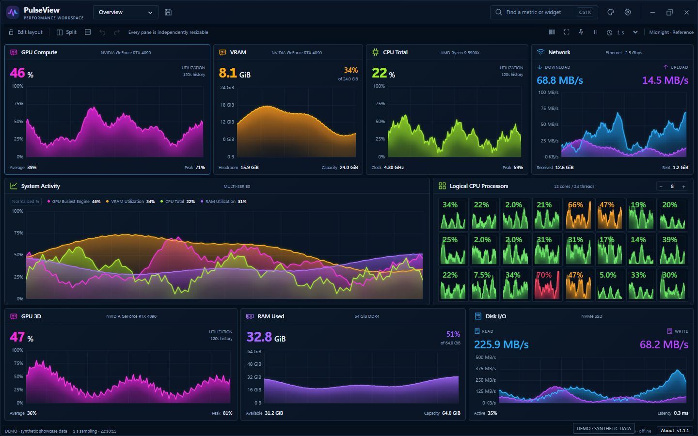
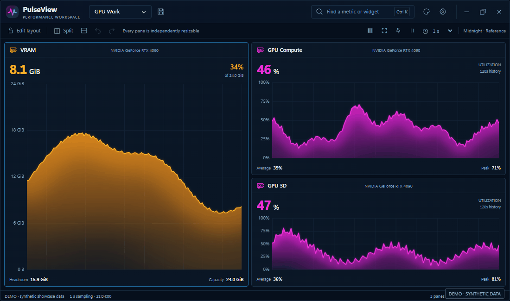
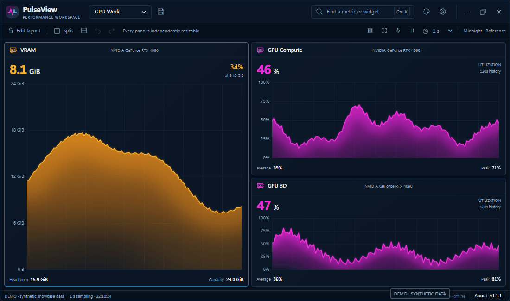

# PulseView

مانیتور پرفورمنس ویندوز با پنل‌های قابل تقسیم، نمودارهای زنده و چیدمان‌های ذخیره‌شدنی.

**[دانلود نصب‌کنندهٔ Windows 11 x64](https://github.com/MoslemCG/PulseView/releases/latest/download/PulseView-Setup-x64.exe)** · [نسخهٔ ZIP](https://github.com/MoslemCG/PulseView/releases/latest/download/PulseView-Portable-x64.zip) · [نسخه‌ها](https://github.com/MoslemCG/PulseView/releases) · [English](README.md)

نصب‌کننده را اجرا کنید و PulseView را از Start باز کنید. برای نسخهٔ ZIP، فایل را استخراج و `PulseView.exe` را اجرا کنید.

**نسخهٔ 1.1.1** · جزئیات نسخه در **About** پایین پنجره یا منوی راست‌کلیک پنل‌هاست. نصب‌کننده فعلاً امضای دیجیتال ندارد.

تصاویر و انیمیشن‌ها از پیش‌نمایش برنامه با داده‌های نمایشی **DEMO** تهیه شده‌اند.

## امکانات

- تقسیم مستقل پنل‌ها، تغییر اندازه، جابه‌جایی ویجت‌ها و Undo.
- نمایش CPU، پردازنده‌های منطقی، موتورهای GPU، VRAM، رم، شبکه و دیسک.
- مشاهدهٔ مقدار نمونه با Hover و تنظیم نوع، رنگ، واحد و تاریخچهٔ نمودار.
- حالت فقط نمودارها با میدل‌کلیک یا **Ctrl+Shift+C**؛ بازگشت با **Escape**.
- هشت اسکین آماده و پشتیبانی از CSS سفارشی.
- شش چیدمان آماده، ذخیره با **Ctrl+S** و ورود و خروج پریست JSON.

[راهنمای بیلد و توسعه](docs/BUILDING.md) · [تعریف معیارها](docs/METRICS.md) · [وضعیت تست‌ها](docs/TEST_REPORT.md) · [مجوز MIT](LICENSE)
