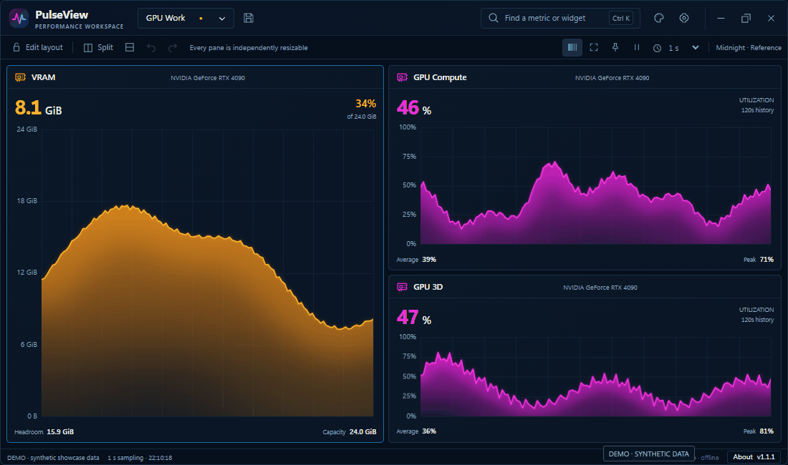
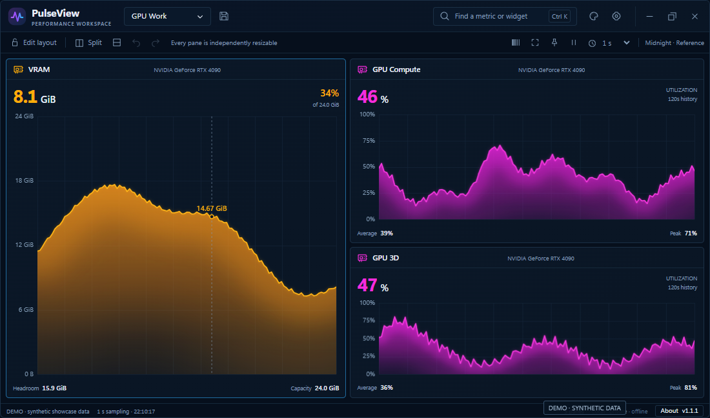
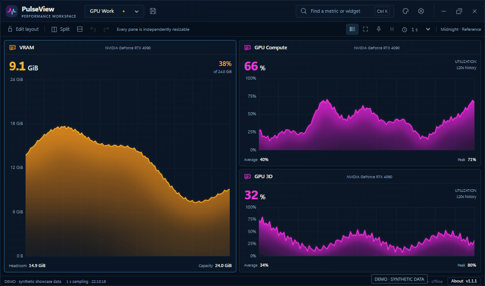
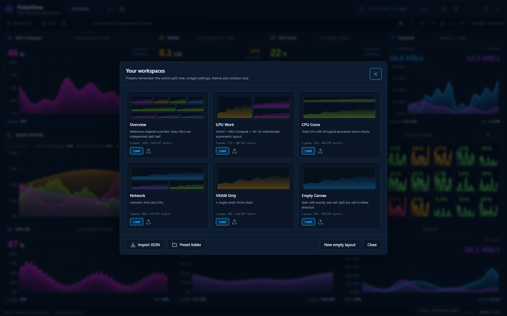

# PulseView

A compact Windows performance monitor with customizable panes, live charts and saved layouts.

**[Download for Windows 11 x64](https://github.com/MoslemCG/PulseView/releases/latest/download/PulseView-Setup-x64.exe)** · [Portable ZIP](https://github.com/MoslemCG/PulseView/releases/latest/download/PulseView-Portable-x64.zip) · [Releases](https://github.com/MoslemCG/PulseView/releases) · [فارسی](README.fa.md)

Run Setup, then open PulseView from Start. For the portable edition, extract the ZIP and run `PulseView.exe`.

**v1.1.1** · Version details: **About** in the footer or pane right-click menu. Installer currently unsigned.


Screenshots and GIFs use the app's browser preview with labeled **DEMO** data.

## Flexible layouts

Split any pane horizontally or vertically, resize dividers, swap widgets and undo changes.


## Live metrics

Monitor CPU, logical processors, GPU engines, VRAM, memory, network and disk. Unavailable readings show `—`.



## Chart controls

Inspect recorded samples on hover; customize chart types, colors, units and history.



## Charts-only mode

Middle-click a chart or press **Ctrl+Shift+C** to toggle the application bars. **Escape** restores them.



## Skins

Eight built-in skins, plus [custom CSS themes](docs/THEMES.md).


## Saved workspaces

Start with six built-in layouts. Save your own with **Ctrl+S**, or import and export JSON presets.



## Build from source

Requires Visual Studio 2022 C++ tools, Windows SDK 10.0.22621+, CMake 3.24+ and WebView2 Runtime.

```powershell
cmake --preset windows-x64
cmake --build --preset release --parallel
ctest --preset windows-release
.\out\build\windows-x64\bin\Release\PulseView.exe
```

[Build & development guide](docs/BUILDING.md) · [Metric definitions](docs/METRICS.md) · [Test status](docs/TEST_REPORT.md) · [Contributing file rules](docs/FILE_POLICY.md) · [Security](SECURITY.md)

[MIT License](LICENSE) · [Third-party notices](THIRD_PARTY_NOTICES.md)
