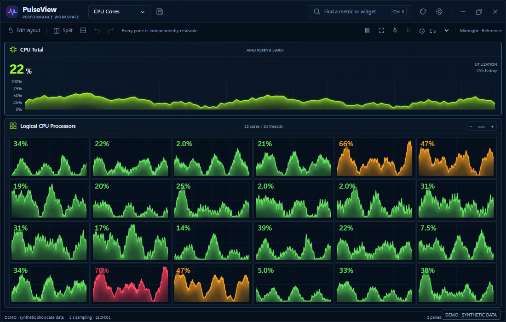
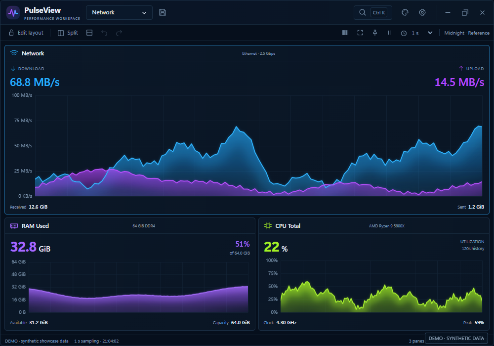
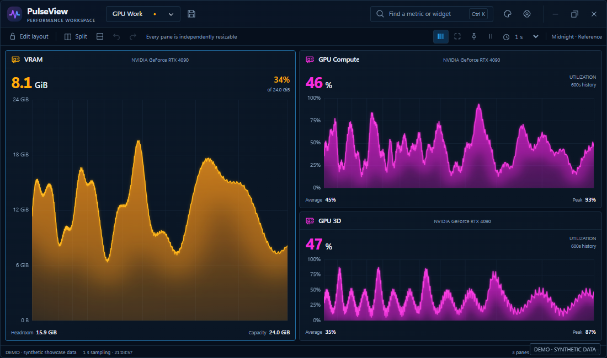
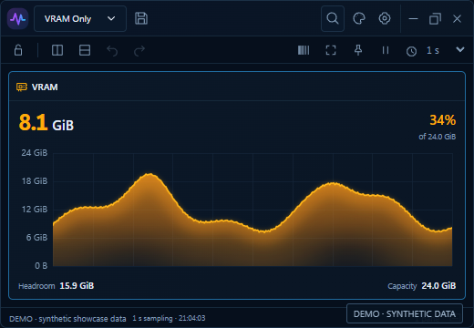
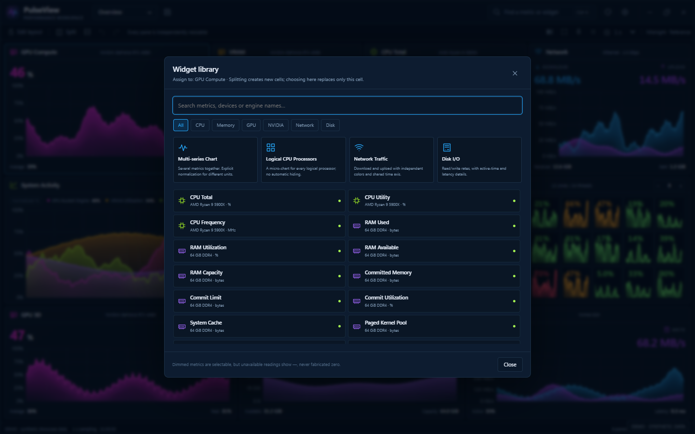
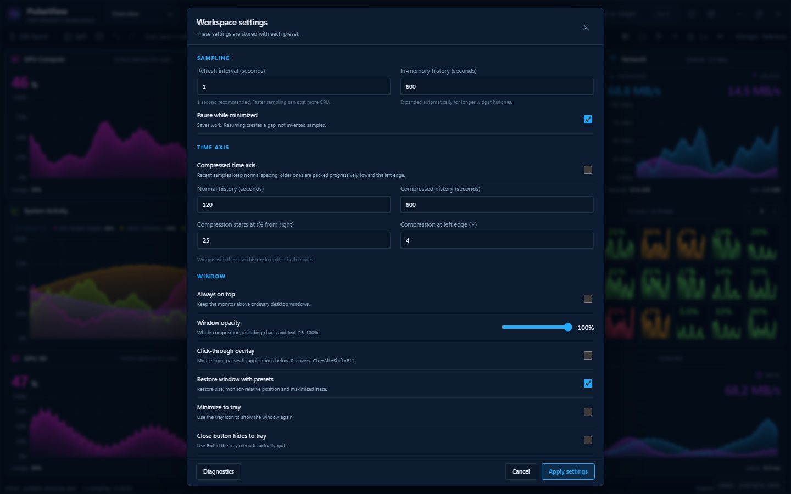

# PulseView

**Your performance workspace, arranged your way.**

A compact **Windows 11 x64** desktop monitor with independently splittable panes,
vivid history charts and reusable layouts. Built with C++20, Win32 and WebView2,
with a local HTML/CSS/JavaScript interface.


**Media note:** every image and animation below shows the real frontend in
browser **Demo mode**, with deliberately varied synthetic showcase readings.
These are UI demonstrations, not hardware benchmarks. Native mode reads Windows
providers and never falls back to simulated values.

[Features](#features) · [Build & run](#build--run) · [Shortcuts](#shortcuts) ·
[Development](#development) · [Documentation](#documentation) · [فارسی](README.fa.md)

## Features

### A layout that follows your workflow

Start with one pane. Split it left/right or top/bottom, then split either child
again. Each divider has its own ratio, so a wide graph can sit beside a stack of
smaller ones. Drag dividers to resize, swap widgets with their drag handles, and
undo layout changes. Double-click a chart or its title to focus it; double-click
again or press Escape to restore the complete layout.


Each workspace is a recursive split tree. Resizing keeps its panes and ratios;
oversized workspaces scroll. Safety limits are 128 panes and 32 split levels.

### GPU activity and VRAM, side by side

Keep a large VRAM history beside Compute and 3D activity, or make a compact
single-metric window. Each widget can have its own chart type, units, history,
colors, fill strength, line width, axes and statistics. Sharp traces and layered
gradients preserve the recorded shape of each series.


**Metric names matter:** Compute, CUDA, NVIDIA GPU activity, memory-controller
activity and allocated VRAM are different readings. CUDA is available only when
the driver exposes an identifiable CUDA engine. Unsupported readings remain
unavailable. See [metric definitions](docs/METRICS.md).

### Every logical processor has a history

Watch total CPU activity and a separate mini-chart for each discovered logical
processor. Choose the column count or let the pane arrange them automatically.
Load colors help spot busy threads, while internal scrolling keeps all processors
reachable in a small pane.



### Network, memory and disk at a glance

Track receive/transmit rates, physical memory and disk I/O beside other metrics.
Network units can display bytes per second or bits per second; the default is
scaled bytes. Interface traffic can include LAN or VPN traffic. Disk I/O and
volume capacity have separate meanings.



### Inspect samples and see more history

Move over a chart to mark a recorded sample and see its value near the point.
The selected sample stays anchored until the pointer moves again. Hover uses
stored samples and their units; it does not invent intermediate measurements.
The compressed time axis gives recent samples more space while retaining a
longer view of older activity. Toggle it from the toolbar or pane menu.




### Charts-only mode for a compact workspace

**Middle-click a chart** or press **Ctrl+Shift+C** to hide the global application
bars. Pane titles remain visible, and the same chart canvases, history and layout
stay in place. Repeat the gesture or use Escape to restore the bars. The native
host can adjust its frame to preserve the chart workspace; the browser demo below
uses the space freed by the bars.


For a tiny dedicated monitor, start with the VRAM Only preset:



### Eight skins, plus your own CSS

Choose **Midnight, Graphite, Onyx, Aurora, Amethyst, Cobalt, Ember or Ivory**.
Every skin uses the same widgets and layout. Custom CSS can change surfaces,
typography and each chart family's color ramp without rebuilding the app.
Explicit per-widget appearance overrides remain yours until you reset them.


Start with [custom-ocean.css](examples/custom-ocean.css) or
[custom-ember.css](examples/custom-ember.css). The [theme guide](docs/THEMES.md)
documents tokens, chart ramps and safe-mode recovery.

### Choose widgets and save complete workspaces

Open the widget library with **Ctrl+K**. Assign individual metrics, multi-series
comparisons, logical-processor bundles, network traffic or disk I/O to any pane.



Six starting layouts cover Overview, GPU Work, CPU Cores, Network, VRAM Only
and Empty Canvas. Save your own layout with **Ctrl+S**, or import/export JSON
presets. Native presets are files under `%LOCALAPPDATA%\PulseView\presets`;
the automatic session draft stays separate from named saves. Presets store
configuration, not time-series recordings.


### Control sampling and window behavior

Configure sampling, history, always-on-top, opacity and tray behavior. Sampling
defaults to one second and is independent from chart rendering. Click-through is
opt-in and requires working recovery controls; startup resets it to interactive
mode. **Ctrl+Alt+Shift+F11** or tray recovery restores mouse input.



The demo shows the settings interface. Native opacity and cross-application input
still require Windows acceptance testing.

## Build & run

This repository distributes **source**. A signed installer and automatic updates
are outside the current scope.

| Requirement | Version / component |
|---|---|
| Operating system | Windows 11 x64 |
| C++ tools | Visual Studio 2022 or Build Tools, MSVC v143, Desktop development with C++ |
| Windows SDK | 10.0.22621 or newer |
| CMake | 3.24 or newer |
| Runtime | Microsoft Edge WebView2 Evergreen x64 |

From the project directory in PowerShell:

```powershell
cmake --preset windows-x64
cmake --build --preset release --parallel
ctest --preset windows-release
.\out\build\windows-x64\bin\Release\PulseView.exe
```

Or use `./scripts/build.ps1 -Configuration Release -Run`. Keep `ui` beside the
executable. Node is not required for the production build. The first configure
retrieves pinned WebView2 SDK and nlohmann/json dependencies over HTTPS. See
[BUILDING.md](docs/BUILDING.md) for offline paths, Debug builds, prerequisites
and application ZIP packaging.

**Validation status:** frontend and portable C++ math checks have passed. Limited
native UI capture has also been performed; complete native Windows storage,
hardware, DPI, opacity and input acceptance remains pending. See the
[test report](docs/TEST_REPORT.md) and [Windows acceptance checklist](docs/WINDOWS_ACCEPTANCE.md).

## Shortcuts

| Shortcut | Action |
|---|---|
| Middle-click / Ctrl+Shift+C | Toggle global application bars |
| Double-click chart or pane title | Focus / restore pane |
| Escape | Close dialog, restore bars, then restore focused layout |
| Ctrl+K | Widget library |
| Ctrl+S | Save preset |
| Ctrl+Alt+V / Ctrl+Alt+H | Split left/right or top/bottom |
| Ctrl+Z / Ctrl+Y | Undo / redo layout |
| Space | Pause / resume sampling |
| Ctrl+Alt+Shift+F11 | Global native overlay recovery |
| Ctrl+Alt+Shift+1…9 | First nine saved presets, when registration succeeds |

Close an existing instance before safe-mode recovery:

```powershell
.\out\build\windows-x64\bin\Release\PulseView.exe --safe-mode
```

## Development

The frontend uses plain ES modules and Canvas. Production has no frontend package
installation, CDN, account or local HTTP server. The developer browser preview
uses simulated data and separate browser storage:

```powershell
python scripts/preview.py
```

For contributors, Node 20+ runs the source checks and publication hooks:

```powershell
npm run setup:git
npm run check
npm test
npm run check:publication
```

Read [FILE_POLICY.md](docs/FILE_POLICY.md) before adding files. Permanent code,
tests and docs belong in their owning directories; builds, test output and
experiments go under ignored `out/`, private inputs under `.local/`. Hooks check
staged paths and outgoing commit history. Each new clone must enable them once.

Optional browser regression tools and README-media capture:

```powershell
npm install --no-save typescript
python -m pip install playwright pillow
python -m playwright install chromium
python tests/browser_test.py
python tests/revision_browser_test.py
python scripts/capture-readme.py
```

Browser tests write to `out/test-results/`. The capture tool writes labeled
synthetic media to `out/readme-media/`; selected assets are reviewed before
promotion into docs. Set `PULSEVIEW_CHROMIUM` to an existing Chromium executable
when needed. Portable C++ commands are in [agent.md](agent.md).

## Documentation

| Guide | Contents |
|---|---|
| [Architecture](docs/ARCHITECTURE.md) | Split-tree model, data flow and state ownership |
| [Metrics](docs/METRICS.md) | Providers, units, availability and limitations |
| [Presets](docs/PRESETS.md) | Saved workspace format and validation |
| [Themes](docs/THEMES.md) | CSS tokens and chart styling |
| [Protocol](docs/PROTOCOL.md) | Narrow native/frontend RPC contract |
| [Media provenance](docs/MEDIA.md) | Capture method and synthetic-data disclosure |
| [Security](SECURITY.md) | Reporting and diagnostic privacy |
| [Agent handoff](agent.md) | Product invariants and required checks |

CPU/motherboard temperatures requiring another driver, process management,
recordings, cloud sync, remote monitoring, GPU tuning, ARM64 and cross-platform
native hosts are outside the current scope. Unsupported readings remain unavailable.

## License

Original source is [MIT licensed](LICENSE). See [third-party notices](THIRD_PARTY_NOTICES.md)
for dependency and asset scope. The original supplied design-reference PNGs remain
local because public redistribution permission is unestablished; see
[design availability](docs/design/README.md).
